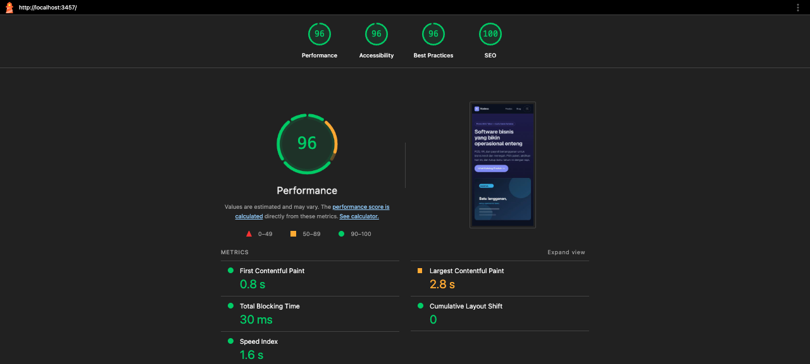

# Kodeva — Promo Akhir Tahun Campaign Site & Mini Marketplace

A polished, responsive campaign website and frontend-only mini marketplace for the fictional brand **Kodeva** (subscription-licensed business software for SMEs: POS, HR/payroll, add-ons). Campaign: **Promo Akhir Tahun**.

Built for the Kodeva Fullstack Skill Test (see `CODING_AGENT_BRIEF.md`).

---

## Actual time spent

Approximately **2 hours wall-clock** (single working session, 2026-10-13, ~18:30–20:30 WIB). The implementation was executed end-to-end by an AI coding agent (Command Code) under the author's direction; per-milestone wall-clock can be reconstructed from the Git commit timestamps, which are preserved un-squashed.

## Live deployment

> **Not yet deployed at the time of writing** — deployment requires an account the author must create. The app is a single Next.js application and deploys to Vercel's free tier with zero code changes:
>
> 1. Push this repository to GitHub.
> 2. Import it on [vercel.com/new](https://vercel.com/new) (free "Hobby" tier).
> 3. Set the environment variables from `.env.example` (see CMS setup below — Sanity cloud is free).
> 4. Set `NEXT_PUBLIC_SITE_URL` to the deployment URL so canonical/OG/sitemap URLs are correct.
>
> **Production URL:** _fill in after deploying_ — `https://…`
> **CMS/admin URL:** `https://…/studio` (embedded in the same deployment)
> **Demo credentials:** the Sanity Studio at `/studio` is gated by Sanity accounts. Invite the reviewer's email (free) via *sanity.io/manage → Members*, or share the demo account credentials privately in the submission email.

## Local setup

Requirements: Node.js 20+ (built with Node 24), pnpm 11.

```bash
pnpm install
pnpm dev        # http://localhost:3000 — works immediately, no env vars needed
```

Without Sanity env vars the site runs on **typed JSON fixtures** (`lib/content/fixtures.ts`) — identical content to the CMS seed. Leads are stored locally in `.data/leads.json`.

Useful scripts:

| Command | Purpose |
|---|---|
| `pnpm dev` / `pnpm build` / `pnpm start` | develop / production build / serve |
| `pnpm test` | vitest suite (pricing, quota, validation) |
| `pnpm typecheck` / `pnpm lint` | tsc --noEmit / eslint |
| `pnpm generate:seed` | regenerate `seed/seed.ndjson` from fixtures |
| `pnpm generate:images` | regenerate placeholder SVG assets |

### Environment variables (`.env.example`)

| Variable | Required | Purpose |
|---|---|---|
| `NEXT_PUBLIC_SITE_URL` | prod | Canonical/OG/sitemap base URL |
| `NEXT_PUBLIC_SANITY_PROJECT_ID` | for CMS | Sanity project (public, safe in browser) |
| `NEXT_PUBLIC_SANITY_DATASET` | for CMS | Usually `production` |
| `NEXT_PUBLIC_SANITY_API_VERSION` | for CMS | GROQ API version |
| `SANITY_API_WRITE_TOKEN` | for CMS leads | Server-only token (Editor role) so `/api/leads` can write lead documents |
| `SANITY_REVALIDATE_SECRET` | for live CMS | Shared secret for the publish webhook |

### CMS setup (one-time, ~10 minutes)

1. Create a project at [sanity.io/manage](https://www.sanity.io/manage) (free tier), copy the project ID into `.env.local` (see `.env.example`).
2. Create an API token (Editor role) for `SANITY_API_WRITE_TOKEN` — **server-side only**, never shipped to the browser.
3. Seed the demo content (uploads images too):
   ```bash
   pnpm dlx sanity@latest login
   pnpm dlx sanity@latest datasets import seed/seed.ndjson production --replace
   ```
4. Configure the publish webhook in *sanity.io/manage → API → Webhooks*:
   - URL: `https://<your-deployment>/api/revalidate?secret=<SANITY_REVALIDATE_SECRET>`
   - Trigger on: create, update, delete (all documents). HTTP POST.
   - Header `x-webhook-secret` may be used instead of the query param.
5. Invite the reviewer account to the project for the CMS demo.

## Stack, templates, and libraries (and why)

| Choice | Reason |
|---|---|
| **Next.js 16.4 App Router + TypeScript** (existing `create-next-app` scaffold) | The repo was scaffolded with it; the brief says reuse sound conventions. Strict TypeScript throughout (`pnpm typecheck` clean). |
| **Tailwind CSS v4** (via Turbopack loader) | Already configured; utility classes keep the design system small and inline. |
| **Sanity CMS** (embedded Studio at `/studio`, `next-sanity`) | Free tier, TypeScript-first schemas, hosted content delivery, and a native webhook → on-demand revalidation story. The Studio is embedded in the same app so one deployment serves both the site and the CMS demo. Marketing users edit everything without a developer. |
| **Typed JSON fixtures** (zero-config fallback) | The content layer falls back to fixtures when Sanity env vars are absent, so reviewers can run the site with no accounts, and CMS outages degrade gracefully instead of 500-ing. Same TypeScript shapes map both sources. |
| **Mock API** (`/api/products`, `/api/orders`) | The marketplace is frontend-only per the brief: products are served over a mock API backed by the same content layer; `?simulate=error` on `/api/products` lets reviewers test client failure handling. Orders are validated and "paid" server-side without any real payment integration. |
| **zustand + persist** (cart) | ~1 KB, no boilerplate; `persist` gives cart survival across refreshes out of the box. All mutations validate through the pricing engine — the store holds no money math. |
| **zod** (validation) | One schema per payload shared by client forms and server route handlers, so client UX and server enforcement can never drift. |
| **@portabletext/react** (rich text) | Renders the same portable-text article bodies from both Sanity and fixtures. |
| **vitest** | Fast, zero-config unit tests for the pure pricing/quota/validation modules (30 tests). |
| No UI kit / component library | The design is small and bespoke; a kit would add JS weight against the mobile performance target. |

## Architecture

```
app/
  (site)/                  # marketing site chrome (header + cart + footer)
    page.tsx               # landing: hero, featured, testimonials, FAQ, lead form
    products/              # catalog + [slug] detail (package selector)
    blog/                  # index, page/[page] pagination, [slug] articles
    cart/ checkout/        # marketplace flow
  studio/[[...tool]]/      # embedded Sanity Studio (admin)
  api/
    leads/                 # POST: validate + spam-check + persist leads
    orders/                # POST: mock payment processor (recomputes prices/quota server-side)
    products/              # GET: mock product API (?simulate=error)
    revalidate/            # POST: Sanity publish webhook → revalidateTag
  sitemap.ts robots.ts opengraph-image.tsx
lib/
  content/                 # content layer: Sanity client + mappers + fixture fallback
  marketplace/pricing.ts   # SINGLE SOURCE for prices, totals, quota validation
  marketplace/cart-store.ts# zustand cart (delegates all math to pricing.ts)
  analytics/               # dataLayer events + UTM capture/persistence
  validation.ts            # zod schemas shared client/server
  types.ts                 # domain models (products, packages, cart, articles, leads, orders)
sanity/schema-types/       # CMS schemas (landingPage singleton, product, article, lead)
tests/                     # vitest suites
scripts/                   # image + seed generators
```

Key decisions:

- **One calculation source.** Every rupiah flows through `lib/marketplace/pricing.ts` (`priceCart`, `applyCartChange`, `validateCartForCheckout`). UI, cart store, and the checkout API cannot disagree. The checkout route recomputes all prices and quota from the catalog server-side and never trusts client numbers.
- **Promo quota is per-product, cross-variant.** Adding 10 Basic + 5 Pro of POS consumes 15 of POS's remaining quota; any add/update that would exceed it is rejected with a clear message before commit (client-side for UX, again server-side at checkout as the safety net).
- **Next 16 Cache Components.** Content reads are wrapped in `use cache` + `cacheTag("content")` with a long lifetime; publishing in Sanity fires the webhook → `revalidateTag("content")`. Pages prerender as static shells (see Lighthouse below). The embedded Studio is the one intentionally dynamic route (`connection()` marker) because the Studio shell cannot be prerendered.

## CMS publishing, caching, and revalidation

- **Who edits what:** hero (eyebrow/title/subtitle/image/CTA), featured product order, testimonials, FAQ, all products (incl. prices, package pricing, quota numbers), and articles (body, category, draft/published, related products) are CMS fields. Section order/visibility stays in code (documented assumption below).
- **Publish → visible flow:** publish in Studio → Sanity webhook POSTs `/api/revalidate` → `revalidateTag("content")` (stale-while-revalidate) → the next visitor request regenerates the page from fresh CMS data.
- **Expected propagation:** effectively **seconds** — the first request after publish triggers regeneration; concurrent requests may briefly serve the previous version (stale-while-revalidate semantics). No manual redeploy is involved.
- **Fallback:** if Sanity is unreachable at render time, the content layer serves the fixture data rather than erroring (availability over absolute freshness for this demo; noted as a trade-off).
- **Drafts:** the public GROQ queries filter `published == true`, so draft articles are never exposed; unknown or draft slugs 404. (Known Next.js nuance: with ISR, the *first* request for a never-seen slug streams a 200 shell whose body is the 404 UI with `noindex`; repeat requests serve a proper 404. Content is never leaked.)

## Marketing tracking

All events go to `window.dataLayer` with GA4-style names and ecommerce payloads (item id/name/category/variant/price/quantity/currency + remaining promo quota), plus campaign attribution from UTM storage:

| Event | Where it fires | Duplicate protection |
|---|---|---|
| `view_item` | product detail, per product+package combination | ref-guard keyed on `productId:packageId` — re-renders cannot re-fire the same key |
| `add_to_cart` | inside the add-to-cart click handler only | handler-scoped by construction |
| `begin_checkout` | once per checkout mount with a non-empty cart | ref guard |
| `cta_click` *(custom, documented)* | landing hero CTA click handler | handler-scoped by construction |

**Observability without a GA account:** in development every push is mirrored to the browser console (`[dataLayer] …`). In production, open DevTools and inspect `window.dataLayer`. Verification evidence from an automated headless-browser session is recorded in `AI_LOG.md`; the mock order route also logs the full order payload (including UTM) server-side.

**UTM persistence:** captured on first load from the URL (all five standard params) into `localStorage` key `kodeva_utm`. Policy: **last-touch overwrite** (a new campaign URL replaces the entry) with a **30-day lifetime** refreshed on each capture. Attribution survives navigation and refreshes, and is attached to lead submissions (`/api/leads`) and the mock order payload (`/api/orders`) — a user who lands via an Instagram ad and submits the form from another page keeps their attribution.

## Assumptions for ambiguous requirements

1. **Lead contact method:** either email **or** WhatsApp is required (at least one; both allowed). Enforced by a shared zod refinement client- and server-side.
2. **Quota semantics:** "remaining promotional license quota" constrains the combined quantity of one product across all package variants in the cart (explicitly required), and the same combined number is what the product page shows as remaining.
3. **Payment simulation:** deterministic and observable — any buyer email containing `+fail` (e.g. `buyer+fail@example.com`) fails; everything else succeeds. Documented on the checkout page ("Bayar Sekarang (simulasi)").
4. **"Products may come from typed JSON fixtures or a mock API"** was read as: the marketplace needs no real backend, while the landing page's *featured products* and article relations must be marketing-editable — so products live in the CMS and the mock API serves them from the content layer.
5. **Currency/locale:** IDR with `id-ID` formatting via one `siteConfig` module; copy lives in the CMS, so a future Malaysia/Singapore variant is a config/CMS change (full localization intentionally deferred — see below).
6. **Section order/visibility** stays in code; CMS controls for it are listed as a bonus and not implemented.
7. **Fixture mode is a dev/reviewer convenience.** Production/demo deployments configure Sanity; the fixture fallback is explicitly documented as not serverless-persistent (e.g. `.data/leads.json`).

## What is complete / incomplete

**Complete (all mandatory scope):**
- Landing page fully CMS-managed (hero, featured products, testimonials, FAQ) + lead form (validation, honeypot + time-trap spam protection, persistence, marketing-viewable in Studio)
- Blog with pagination, slug URLs, CMS-managed fields, draft/published visibility, related products
- Marketplace: 7 products, category filter, product detail with gallery/features/prices/remaining quota, Basic/Pro/Business packages with live price updates, cart (add/update/remove, cross-variant quota, subtotal, persistence, always-reachable via header), checkout (validation, summary, simulated success/failure with recovery path, UTM attribution)
- Loading/error/empty/not-found states, mock API failure injection
- GA4-style dataLayer events + UTM capture/persistence/end-to-end attribution
- SEO: per-page titles/descriptions, canonicals, Open Graph/Twitter cards (WhatsApp preview), generated OG image, JSON-LD (Organization, FAQPage, Product with offers, BlogPosting), sitemap, robots
- Mobile-first responsive design; Lighthouse mobile **Performance 96** (target ≥ 80) — see `docs/lighthouse/lighthouse-mobile-screenshot.png`
- 30 unit tests covering pricing, cross-variant quota, checkout validation, payment simulation; typecheck + lint + build clean
- `AI_LOG.md`, seed data, `.env.example`, un-squashed commit history

**Incomplete / deferred (intentionally, per the "reliable core over extras" rule):**
- Actual deployment (requires account creation; steps documented above)
- CMS draft preview, scheduled publishing, vouchers, catalog search/sort in shareable URLs (bonus items)
- Full i18n (locale/currency are config-ready; translations not required by the brief)

**With one more week:** deployment + reviewer walkthrough video; CMS section-order/visibility controls; Playwright end-to-end tests over the checkout flow; draft preview via Sanity presentation tool; voucher module on top of the pricing engine; i18n routing (id-ID / ms-MY / en-SG) with localized CMS field variants.

## Marketplace future-backend integration plan

The current mock layer (`/api/orders`, content layer, pricing engine) is shaped so a real backend can replace it without touching UI code:

- **Endpoints:** `GET /products` (catalog, cacheable), `POST /orders` (create order + initiate payment), `GET /orders/:id` (status), `POST /payments/webhook` (gateway callback), `GET /licenses/:orderId` (delivery after verified payment), plus `POST /leads`.
- **Secure payment flow:** order created server-side from validated cart + server-recomputed prices (already the case locally); client is redirected to the gateway or tokenized widget; the server never trusts a client "paid" flag. Order statuses: `pending → paid | failed | expired`, advanced **only** by verified webhook events.
- **Webhooks:** verify signature + timestamp, persist raw event, process **idempotently** (unique event id + transactional upsert) so gateway retries are safe; license delivery happens only after a `paid` transition.
- **Promo quota under concurrency:** move the counter into the database and decrement **atomically** per order (`UPDATE products SET quota_remaining = quota_remaining - $n WHERE id = $1 AND quota_remaining >= $n` returning row count, or a `SELECT … FOR UPDATE` transaction); reserve on order creation with an expiry job (release reservations for abandoned/unpaid orders after e.g. 30 minutes). The client-side quota numbers become a UI hint, never the authority.
- **License delivery:** generate license keys only in the post-payment path (webhook-verified), send by email + account page; retries are idempotent per order.

## Lighthouse (mobile, landing page)

**Performance 96 · Accessibility 96 · Best Practices 96 · SEO 100** (FCP 0.8 s, LCP 2.8 s, TBT 30 ms, CLS 0)



Full report: `docs/lighthouse/lighthouse-mobile.html` (open locally) and `docs/lighthouse/lighthouse-mobile.json`.

---

Data on this site is dummy. No real credentials or personal data are committed.
